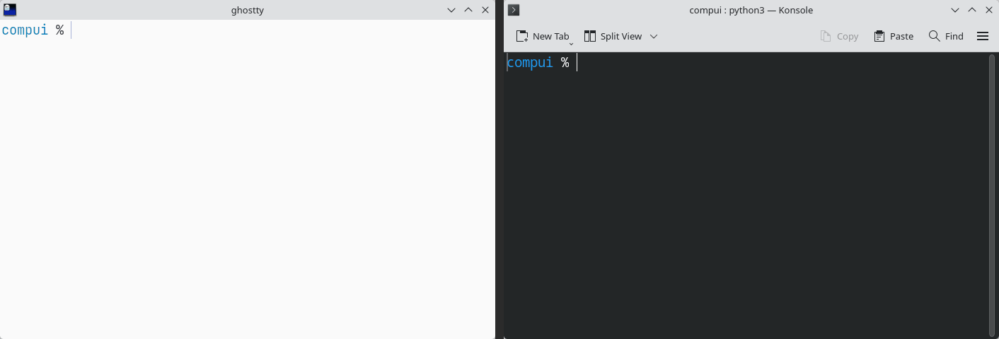

# compUI

IDE style completion popup for terminals you already use (ghostty, konsole, Terminal.app, iTerm2...). Type a command, pick a candidate with up/down, tab to insert. Recent history lines that start with what you typed are listed first.

zsh only.



## Install

```sh
curl -fsSL https://raw.githubusercontent.com/roworu/compui/main/install.sh | sh
```

Then set your terminal's command to `~/.local/bin/compui` (ghostty: `command = ~/.local/bin/compui`).

Konsole: set it as the profile's Command (Settings → Edit Current Profile), not started from your shell, or Konsole warns on every close that compui is still running.

## OS support
Linux: KDE Plasma on Wayland, needs gtk4 and gtk4-layer-shell.
macOS: allow your terminal in Accessibility settings.
